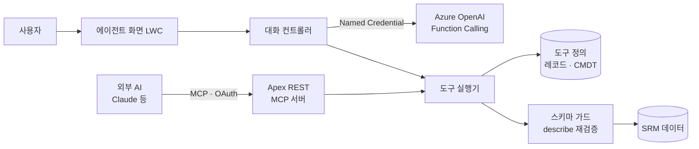

# SRM 업무 에이전트와 MCP 서버

> 말로 구매 업무를 조회하고 처리하는 Salesforce 에이전트를 만들고, 외부 AI(Claude 등)가 원격 커넥터로 같은 기능을 쓸 수 있도록 MCP 서버를 Apex로 직접 구현했습니다.

| 항목 | 내용 |
|---|---|
| 기간 | 2026.08 – 2026.10 |
| 역할 | 에이전트 구조 재설계, 도구 실행기, 자동 생성 파이프라인, MCP 서버 구현 |
| 형태 | 회사 프로젝트 (사내 솔루션 팀) |
| 기술 | Apex, LWC, Azure OpenAI (Function Calling, Structured Outputs), MCP, OAuth, Named / External Credential |

> 회사 프로젝트를 정리한 문서입니다. 회사 소스 코드와 고객 정보는 포함하지 않습니다.

## 할 수 있는 일

- "A사와 B사 견적 비교해 줘", "이번 달 지연된 발주 보여 줘", "이 공급사로 RFQ 발행해 줘"
- 공급사 비교, 견적 비교, 발주 · 납품 상태, 집계, 레코드 생성, 공급자 평가

## 구조

## 풀어낸 문제

### 1. API 키를 브라우저에서 없애기
- 처음 데모는 브라우저가 실시간 연결로 AI를 직접 호출해서 키가 노출될 수 있었습니다.
- **서버 측 Chat Completions 호출**로 바꾸고 인증은 Named / External Credential로 옮겼습니다.

### 2. 도구를 코드가 아니라 데이터로
- 도구가 늘 때마다 Apex 클래스를 새로 만드는 구조였습니다.
- 도구 정의를 레코드와 Custom Metadata로 옮기고, **범용 실행기 3종**(연쇄 조회, 비교, 조건 목록)으로 대부분의 요청을 처리하게 했습니다.
- 설정된 오브젝트 · 필드는 실행 직전 describe로 다시 검증해 동적 SOQL의 보안을 지킵니다.

### 3. 처리 못 한 요청으로 도구 자동 만들기
1. 매칭되는 도구가 없던 요청을 기록합니다.
2. Structured Outputs(json_schema strict)로 도구 초안을 생성하고 스키마를 검증합니다.
3. 자동 배포 후 시험 실행(dry-run)을 하고, 실패가 쌓이면 자동으로 비활성화합니다.

### 4. 대화 기록의 개인정보
- 대화를 저장할 때 사람 · 회사 이름을 `{{Object:Id}}` 토큰으로 바꿔 저장하고, 불러올 때 원래 이름으로 복원합니다. 복원은 타입당 SOQL 한 번으로 처리합니다.

### 5. MCP 서버를 Apex로
- Salesforce가 제공하는 기본 MCP 기능으로는 화면 리소스를 등록할 수 없어서, **Apex REST로 MCP Streamable HTTP를 직접 구현**했습니다 (initialize, tools/list, tools/call, resources).
- 인증은 OAuth 보호 리소스 메타데이터(RFC 9728)로 org의 로그인을 그대로 씁니다.
- AI 답변 안에 공급자 평가지 화면이 바로 뜨는 MCP Apps(ui:// 리소스)를 만들었습니다.

### 6. 쓰기 작업 안전장치
- 데이터를 바꾸는 도구는 **요약 → 사용자 확인 → 실행** 2단계로만 동작합니다.
- 확인 단계에서 넘어온 내용이 바뀌지 않았는지 서명(HMAC)으로 검증합니다.

## 배운 점

- LLM 기능은 모델보다 **도구 설계, 권한, 확인 절차**가 품질을 좌우한다는 것
- 표준 기능의 한계가 보이면 프로토콜 문서를 읽고 직접 구현하는 것이 더 빠를 때가 있다는 것
